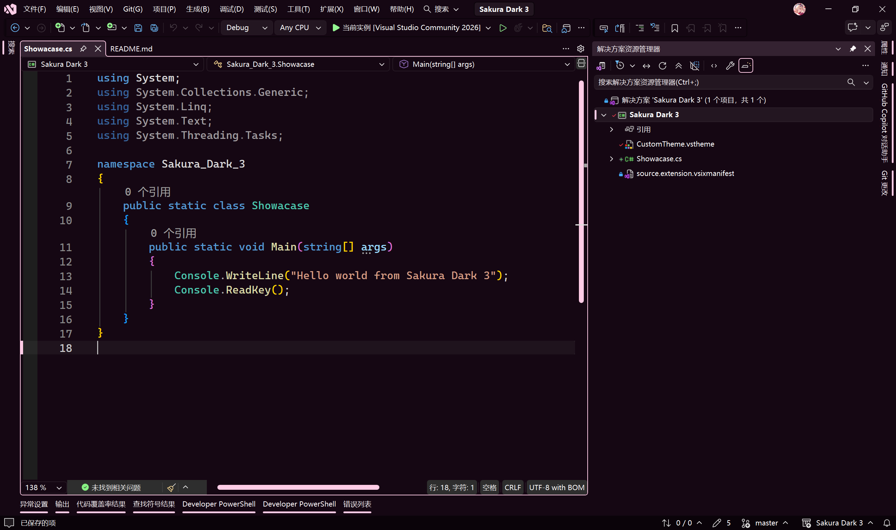
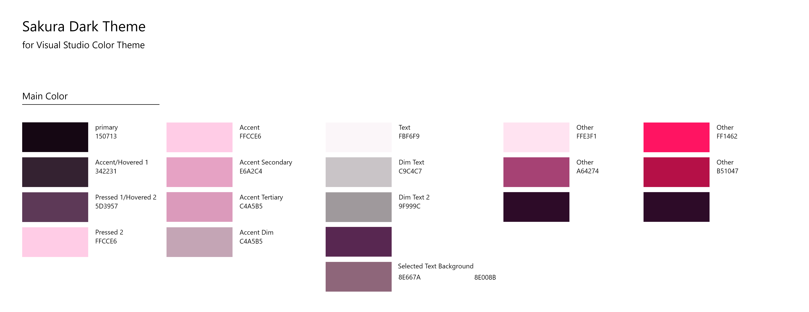

Sakura Dark 3
===

Sakura Dark 3 is a custom high-contrast color theme for Visual Studio 2026, featuring a design in pink and purple color.

Screenshot preview:

Color reference:

To learn more about Visual Studio 2026 theme, please see:

* [Modernize Visual Studio theme colors - Visual Studio (Windows) | Microsoft Learn](https://learn.microsoft.com/en-us/visualstudio/extensibility/migration/modernize-theme-colors?view=visualstudio)

* [Make Visual Studio look the way you want - Visual Studio Blog](https://devblogs.microsoft.com/visualstudio/make-visual-studio-look-the-way-you-want/)